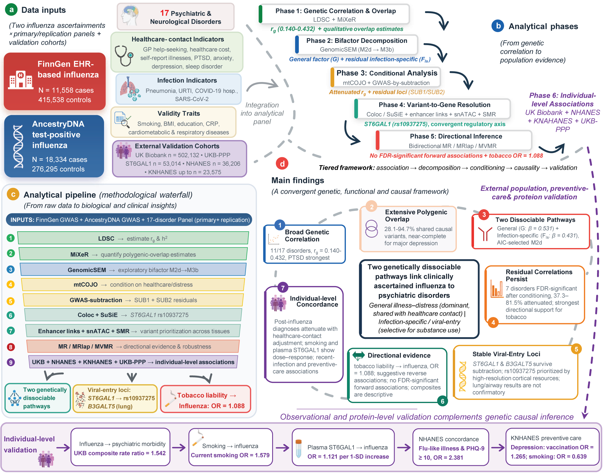

# Care-seeking and addictive behaviours drive the genetic and epidemiological link between influenza and psychiatric disorders

This repository includes the R/Python code and analysis pipelines used to run all analyses for the paper "**Care-seeking and addictive behaviours drive the genetic and epidemiological link between influenza and psychiatric disorders**" and to produce the figures of the paper.

# Graphical Abstract



# Overview

Infection and mental illness frequently co-occur, and the COVID-19 pandemic has reinforced the view that infections harm mental health, yet it remains unresolved whether mental illness and addictive behaviours instead drive infection susceptibility and care-seeking. To disentangle these mechanisms, we developed an integrative genomic and epidemiological framework that decomposes recorded influenza liability into care-seeking, addictive-behaviour and viral-susceptibility layers. We applied this framework to two influenza genome-wide association studies (GWAS) comprising 29,892 health-record and test-confirmed cases, alongside primary and replication GWAS of 17 psychiatric and neurological disorders. Influenza was genetically correlated with 11 disorders (rg = 0.140–0.432), with an overall correlation pattern consistent across definitions, underpinned by model-based evidence of polygenic overlap. Bifactor genomic structural equation modelling further resolved this overlap into two dissociable pathways. Specifically, a general illness–distress dimension indexed by help-seeking and healthcare use accounted for 37.3–81.5% of these correlations, whereas an infection-specific component showed additional loadings for tobacco and alcohol use disorders and opioid-related phenotypes, with the most robust conditional and multivariable evidence for tobacco. Mendelian randomization found no FDR-significant forward associations. Instead, genetic liability to anxiety and tobacco use disorder increased influenza risk, and tobacco use disorder also raised the risk of infection-related hospitalization, an outcome with different ascertainment. Removing the illness–distress dimension via GWAS-by-subtraction generated residual influenza GWAS that retained the viral-entry loci *ST6GAL1* and *B3GALT5*. At *ST6GAL1*, colocalization, fine-mapping, enhancer–gene linking and single-nucleus chromatin profiling converged on the cis-regulatory variant rs10937275, while higher plasma ST6GAL1 protein levels was associated with incident influenza in the UK Biobank (n=52,148). In the UK Biobank (n=502,131), excess psychiatric diagnoses following influenza partially weakened after accounting for prior healthcare contact and concentrated in previously unhospitalized individuals, whereas smoking showed a dose–response relationship with influenza. Similar associations followed upper respiratory tract infection and pneumonia. Similarly, in NHANES (n=36,206), the association between recent flu, pneumonia or ear infection and depression was largely independent of C-reactive protein. Current smoking was associated with recent flu, pneumonia or ear infection (n=35,353). In KNHANES, depression and smoking showed opposite vaccination associations (n=23,502–23,575). Overall, our findings recast the link between influenza and mental health as partly reflecting care-seeking that shapes case recording and addictive behaviour that may increase biological susceptibility. These results warn that health-record phenotypes can partly reflect help-seeking, and they support further evaluation of tobacco treatment to reduce infection risk in psychiatric populations.

# Repo Contents

- [Scripts](./Scripts): R and Python scripts for all analyses and figure generation, organized by analytical stage. *Figure-generation scripts typically complete within minutes; genome-wide analyses (LDSC, MiXeR, mtCOJO, GWAS-by-subtraction, MR) and the UK Biobank cohort extraction were run on a Linux server and require the corresponding summary statistics, reference panels and data access (see Data availability and [data](./data)).*

  **Genetic correlation and polygenic overlap**
  + `ldsc_run.py`, `ldsc_collect.py`. Run and collect cross-trait LD score regression (SNP heritability, genetic correlations, genetic covariance intercepts) for all exposure–panel combinations.
  + `ldsc_rg_forest.R`, `ldsc_h2_obs_barplot.R`, `ldsc_gcov_int_forest.R`, `ldsc_cross_exposure_consistency.R`, `ldsc_rg_panel_consistency.R`. Figures for genetic correlations, heritability, sample-overlap assessment, and cross-exposure/cross-panel consistency.
  + `MiXeR/`. Univariate (`MiXeR-fit1.py`) and bivariate (`MiXeR-fit2.py`) causal mixture model fits and likelihood-ratio tests (`MiXeR-test1.py`, `MiXeR-test2.py`) with data conversion and merging helpers (gsa-mixer v2.2.1, Docker).
  + `MiXeR.export.tables.py`, `MiXeR_grid_figures.py`. MiXeR summary tables and the Venn/conditional-QQ/likelihood figure grids.

  **Genomic structural equation modelling**
  + `GenomicSEM.R`. Model ladder (M0, M1, M2a–M2d, M3b) fitting with DWLS estimation, model comparison, external validity and sensitivity analyses.
  + `GenomicSEM.drawio`. Path diagram source for the selected bifactor model (M2d).
  + `GenomicSEM_bifactor_forest.R`, `GenomicSEM_flu_decomp.R`, `GenomicSEM_loading_heatmap.R`, `GenomicSEM_validity_forest.R`, `GenomicSEM_sensitivity_forest.R`, `GenomicSEM_supplementary_tables.R`. GenomicSEM figures and supplementary tables.

  **Conditioning and GWAS-by-subtraction**
  + `mtCOJO.R`. Conditioning of the influenza GWAS on healthcare-contact and psychological-distress indicator sets (GCTA v1.94.1).
  + `mtCOJO_attenuation_dumbbell.R`, `mtCOJO_attenuation_panel_consistency.R`, `mtCOJO_vs_GenomicSEM_FIs.R`. Attenuation dumbbell plots and concordance with infection-specific loadings.
  + `GWAS-by-subtraction.R`. Residual influenza GWAS (SUB1/SUB2) via GenomicSEM userGWAS, with clumping and lead-locus comparison against the reference meta-analysis.
  + `GWAS-by-subtraction.manhattan.R`, `GWAS-by-subtraction.locus.R`. Manhattan and regional association plots for raw and residual phenotypes.

  **Mendelian randomization**
  + `2sMR.R`. Bidirectional two-sample MR (TwoSampleMR; IVW, MR–Egger, weighted median, MR-PRESSO, Steiger filtering) with fixed-effects panel meta-analysis and power evaluation.
  + `2sMR_forward_meta_forest.R`, `2sMR_reverse_meta_forest.R`, `2sMR_reverse_panel_consistency.R`, `2sMR_sensitivity.R`. MR figures and sensitivity panels.
  + `MRlap.R`, `MRlap.forest.R`, `MRlap_src/`. Sample-overlap- and winner's-curse-corrected MR (MRlap) and forest plots; `MRlap_src` contains the local R package source.
  + `MVMR.single.R`, `MVMR.run.sh`, `MVMR.primary.config.csv`, `MVMR.gscan.config.csv`, `MVMR.extended.config.csv`. Multivariable MR of substance-use liability on influenza (BMI and educational attainment as covariates), covariate substitutions, instrument-selection grid, alternative outcomes, extended infection outcomes and GSCAN smoking proxies.
  + `MVMR.summarize.R`, `MVMR.figures.R`, `MVMR_supplementary_tables.R`, `MVMR.extended.sensitivity.R`, `MVMR.extended.locus.bridge.R`. MVMR summaries, figures and supplementary tables.

  **Locus-to-gene resolution**
  + `coloc.prepare.R`, `coloc.R`, `coloc.pQTL.R`. Bayesian colocalization (coloc.abf) of raw and residual influenza GWAS against brain, lung, immune eQTLs and plasma pQTLs at the ST6GAL1 and B3GALT5 loci.
  + `coloc.SuSiE.R`, `coloc.SuSiE_supplementary_tables.R`, `coloc_supplementary_tables.R`. SuSiE fine-mapping (susie_rss), credible-set tables and consolidated colocalization supplementary tables.
  + `coloc.locuszoom.R`. Multi-panel locus figures (GWAS, eQTL, chromatin annotation, enhancer links).
  + `coloc.enhancer.links.R`, `coloc.enhancer.links_supplementary_tables.R`. EpiMap and PsychENCODE INT-16 enhancer–gene linking.
  + `coloc.snATAC.R`, `coloc.snATAC.dotplot.R`, `coloc.snATAC_supplementary_tables.R`, `coloc.peak_expr.py`. Cell-type-resolved chromatin accessibility (SEA-AD) and donor-level peak–expression coupling.
  + `coloc.SMR.R`, `coloc.SMR.forest.R`. Summary-data-based Mendelian randomization (SMR v1.4.2) with HEIDI tests and the hospitalized-COVID-19 specificity control.

  **Individual-level epidemiological and protein-level analyses**
  + `UK-BioBank.data.extract.py`. Builds the UK Biobank analysis cohort (502,131 participants) from the raw extract: demographics, first-reported influenza (J09–J11) and psychiatric diagnoses, healthcare-contact indicators, smoking phenotypes, death records and Olink proteomics.
  + `UKB.flu_psych_incidence.py`, `UKB.flu_psych_incidence.forest.R`. Incidence rates of psychiatric diagnoses after incident influenza, with healthcare-contact and calendar-period sensitivity analyses and two-year window models.
  + `UKB.smoking_flu.py`, `UKB.smoking_flu.forest.R`. Smoking status and pack-years in relation to subsequent influenza.
  + `UKB.protein_flu.py`, `UKB.protein_flu.forest.R`. Baseline plasma ST6GAL1 abundance and incident influenza.
  + `NHANES.flu_depression.py`, `NHANES.flu_depression.forest.R`. NHANES 2005–2018: associations of self-reported recent flu, pneumonia or ear infection with PHQ-9 depression, C-reactive protein and NDI-linked influenza/pneumonia mortality.
  + `NHANES.smoking_flu.py`, `NHANES.smoking_flu.forest.R`. Smoking status and cigarette dose in relation to the same composite recent-infection item.
  + `KNHANES.depression_vaccination.py`, `KNHANES.depression_vaccination.forest.R`. Depression, perceived stress and smoking in relation to influenza vaccination uptake in KNHANES 2016–2019.

- [Figures](./Figures): Publication-ready figures in PDF and PNG format generated by the code above; [Figures/Figures](./Figures/Figures) contains the combined main and supplementary figures assembled in Adobe Illustrator.

- [Tables](./Tables): All supplementary tables in Excel format (`Supplementary Tables.xlsx` and per-table files), together with analysis summary tables.

- [Source Data](./Source Data): Source data underlying each figure panel.

- [data](./data): Dataset access guide for reproducing the analyses, download links for all public resources (75 GWAS summary-statistics datasets, molecular resources, NHANES, LD reference panels) and the application routes for controlled-access data (UK Biobank individual-level data). See [data/README.md](./data/README.md).

- [GWAS.infos.xlsx](./GWAS.infos.xlsx): Basic information for every GWAS sample included in the analysis.

**Data availability**: This study used publicly available genome-wide association study (GWAS) summary statistics, publicly available molecular datasets and existing individual-level data from UK Biobank, NHANES and KNHANES; no new individual-level data were generated. The influenza GWAS summary statistics are available from FinnGen release 12 (endpoints J10_INFLUENZA, J10_PNEUMONIA and J10_INFLUPNEU; https://www.finngen.fi/en/access_results) and from the GWAS Catalog under accession GCST90432107 (multi-ancestry test-positive influenza meta-analysis, AncestryDNA). Summary statistics for the psychiatric, neurological, indicator and validity traits were obtained from the GWAS Catalog (https://www.ebi.ac.uk/gwas/), the IEU OpenGWAS infrastructure (https://opengwas.io/) and the respective consortia, with accession codes and download links for every dataset listed in Supplementary Table 1. Molecular datasets were obtained from brainSCOPE (single-nucleus cortical eQTLs), PsychENCODE (bulk dorsolateral prefrontal cortex eQTLs and INT-16 enhancer–promoter Hi-C links; [http://resource.psychencode.org](http://resource.psychencode.org/)), GTEx v8 ([https://gtexportal.org](https://gtexportal.org/)), BLUEPRINT ([https://www.blueprint-epigenome.eu](https://www.blueprint-epigenome.eu/)), the UK Biobank Pharma Proteomics Project, INTERVAL, the SEA-AD middle temporal gyrus snATAC-seq atlas (Allen Institute), EpiMap enhancer–gene links, Roadmap Epigenomics chromatin-state models and ENCODE candidate cis-regulatory elements ([https://screen.encodeproject.org](https://screen.encodeproject.org/)). The 1000 Genomes Project European reference panel was used for linkage disequilibrium estimation. Individual-level UK Biobank data are available through the UK Biobank Access Management System (https://www.ukbiobank.ac.uk/enable-your-research/apply-for-access) under application 99946, and NHANES data are publicly available from the US National Center for Health Statistics (https://www.cdc.gov/nchs/nhanes/). KNHANES data are available from the Korea Disease Control and Prevention Agency (https://knhanes.kdca.go.kr/knhanes/eng/main.do).

# System Requirements

Genome-wide analyses were run on a Linux server (Ubuntu 24.04 LTS; 64 CPU cores, 503 GB RAM); figure-generation and table-generation scripts were run in R (version 4.5.1/4.6.0) and Python 3 on a Windows 11 personal computer. On the server above, LD score regression completes within minutes per trait pair, whereas MiXeR fits require several hours per trait pair; the UK Biobank cohort extraction is run once and is the most time-consuming step. All figure and table scripts complete within minutes on a desktop computer.

External software used (versions verified on the analysis server):

```
GCTA                # v1.94.1       (/tools/gcta-1.94.1/gcta64)
PLINK               # v1.90b7.1     (/tools/plink-1.90/plink)
SMR                 # v1.4.2 Linux  (/tools/smr-1.4.2/bin/smr)
LDSC                # Bulik-Sullivan et al., 2015  (/tools/ldsc, run with Python 2.7.16)
gsa-mixer           # v2.2.1        (Docker image ghcr.io/precimed/gsa-mixer:2.2.1)
Python              # 3.13.5        (/tools/Python-3.13.5)
```

R packages used (server R 4.6.1):

```
GenomicRanges       # 1.64.0
GenomicSEM          # 0.0.5
TwoSampleMR         # 0.7.9
coloc               # 5.2.3
cowplot             # 1.2.0
data.table          # 1.18.6.1
dplyr               # 1.2.1
forcats             # 1.0.1
ggplot2             # 4.0.3
ggrepel             # 0.9.8
ggtext              # 0.1.2
glue                # 1.8.1
gridExtra           # 2.3.1
ieugwasr            # 1.1.0
magrittr            # 2.0.5
openxlsx            # 4.2.8.1
parallel            # 4.6.1
patchwork           # 1.3.2
readxl              # 1.5.0
rlang               # 1.3.0
rtracklayer         # 1.72.0
stringr             # 1.6.0
susieR              # 0.14.2
this.path           # 2.8.0
tidyr               # 1.3.2
writexl             # 1.5.4
```

MRlap is not on CRAN and is installed from the local source provided in `Scripts/MRlap_src`.

Python modules used (server Python 3.13.5):

```
numpy               # 2.5.2
pandas              # 3.0.3
scipy               # 1.18.0
statsmodels         # 0.14.6
matplotlib          # 3.11.1
matplotlib_venn     # 1.1.2
h5py                # 3.16.0
scanpy              # 1.12.4
pyliftover          # 0.4.1
```

# Installation

**1. Clone the repository**

```shell
git clone https://github.com/MPU-Li-OmicsLab/influenza_mental_genomics.git
```

**2. Install R and Python dependencies**

R can be downloaded from CRAN (https://cran.r-project.org) and Python from https://www.python.org/. Install the R packages listed above via `install.packages()` (GenomicSEM, TwoSampleMR and susieR are available on CRAN/GitHub; MRlap is installed from `Scripts/MRlap_src`). External tools (LDSC, GCTA, PLINK, gsa-mixer, SMR) should be installed following their respective documentation.

The installation time should be < 30 minutes total on a typical desktop computer, excluding external tools.

# Run the scripts

Execute the analysis and figure scripts located in the [Scripts](./Scripts) directory. To verify the installation without downloading any dataset, run any figure-generation script: these read exclusively from [Tables](./Tables) and [Source Data](./Source Data) (both shipped with the repository) and typically complete within minutes. Re-running the genome-wide analyses requires the input datasets described in [data/README.md](./data/README.md) (GWAS summary statistics, LD reference panels and molecular resources; for the observational analyses, an approved UK Biobank application and the public NHANES files).

# License

This project is covered by the MIT license.
